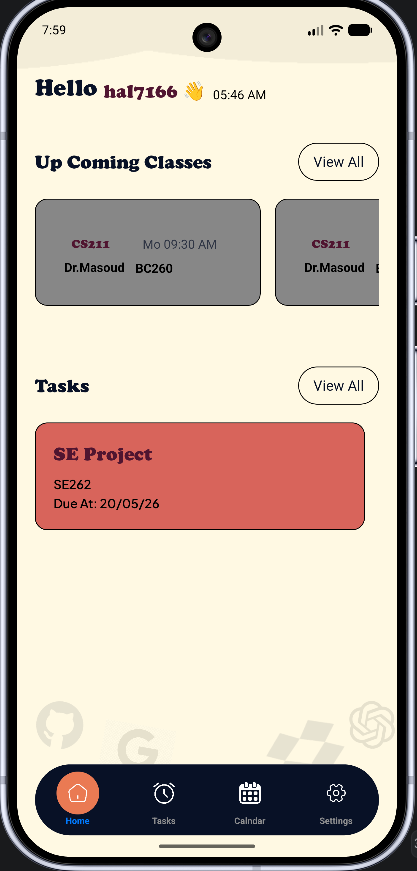

<p align="center">
  
</p>

<h1 align="center">ORB – University Reminder System</h1>

<p align="center">
  A mobile application designed to help university students
  organize their classes, tasks, and reminders.
</p>

<p align="center">
  
</p>

## Features

- **Class Management**
  - Add and manage university classes.
  - View class schedules.
  - Keep class information organized.

- **Task Management**
  - Create and manage tasks.
  - Set reminders for tasks.
  - Keep track of pending tasks.

- **Schedule**
  - View and organize your weekly schedule.
  - Keep track of upcoming classes.

- **User Authentication**
  - Sign in and sign up using Clerk.
  - Manage user accounts.

- **Notifications**
  - Receive notifications and reminders.
  - Get alerts for scheduled tasks.

- **Settings**
  - Switch between light and dark modes.
  - Manage application preferences.

- **Data Storage**
  - Store data using Appwrite.
  - Save local data using Expo SecureStore.
  - Sync classes and tasks between local storage and the cloud.

## Technologies Used

| Technology | Purpose |
|---|---|
| React Native | Mobile application development |
| Expo | Development and building |
| TypeScript | Programming language |
| Expo Router | Navigation |
| Clerk | User authentication |
| Appwrite | Backend and cloud data storage |
| NativeWind | Styling |
| Expo Notifications | Notifications and reminders |
| Expo SecureStore | Local data storage |
| PostHog | Application analytics |

## Project Structure

```text
ORB/
│
├── app/                  # Application screens and navigation
│
├── assets/               # Images, icons, and fonts
│
├── components/           # Reusable UI components
│
├── constants/            # Application constants and data
│
├── hooks/                # Custom React hooks
│
├── lib/                  # Backend and utility functions
│
├── scripts/              # Project scripts
│
├── app.json              # Expo configuration
├── package.json          # Dependencies and scripts
├── tsconfig.json         # TypeScript configuration
├── global.css            # Global styles
└── README.md
```

## Installation

### 1. Clone the repository

```bash
git clone https://github.com/Hal716/ORB.git
```

### 2. Open the project directory

```bash
cd ORB
```

### 3. Install dependencies

```bash
npm install
```

### 4. Configure environment variables

Create a `.env` file in the project root and add the required configuration values:

```env
EXPO_PUBLIC_CLERK_PUBLISHABLE_KEY=
EXPO_PUBLIC_POSTHOG_API_KEY=
EXPO_PUBLIC_POSTHOG_HOST=
```

Make sure to configure the required Appwrite settings in the project as well.

### 5. Start the application

```bash
npx expo start
```

You can then run the application using an Android emulator, iOS simulator, or a compatible development build.

## Application Navigation

The application includes four main sections:

1. **Home:** View the main dashboard.
2. **Tasks:** Manage tasks and reminders.
3. **Schedule:** View university classes and schedules.
4. **Settings:** Manage application preferences.

## Data Management

ORB uses Appwrite to store and retrieve user data.

It also uses Expo SecureStore to save data locally. If cloud synchronization fails, the application can load previously saved local data.

## Contributors

Developed as a university software development project.

**GitHub Repository:**  
https://github.com/Hal716/ORB
